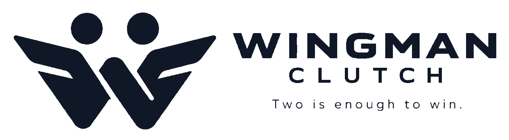
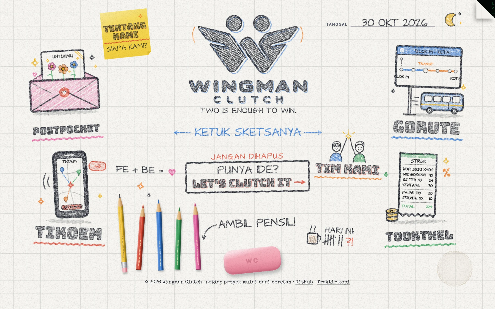
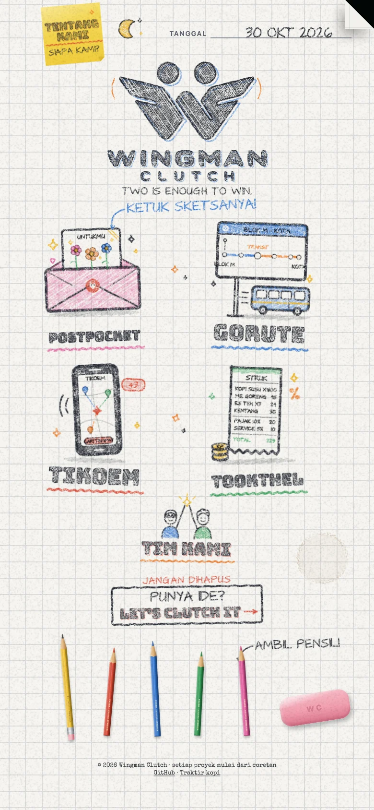
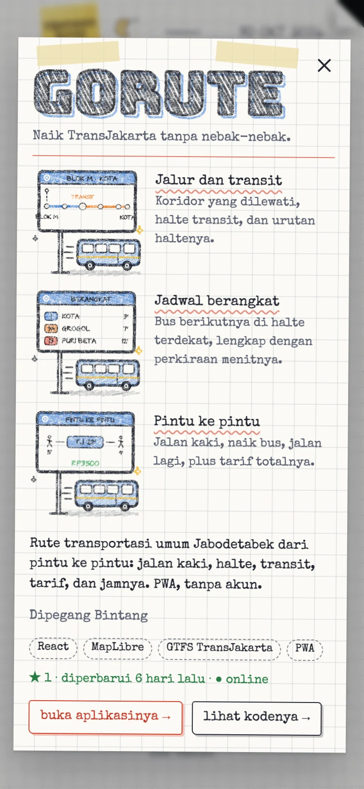
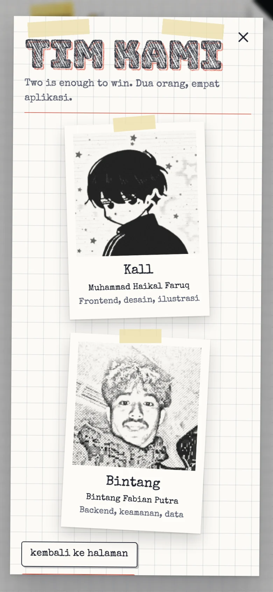
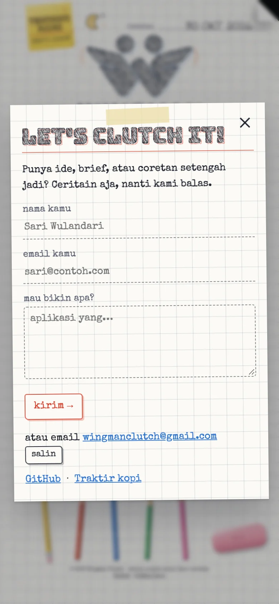
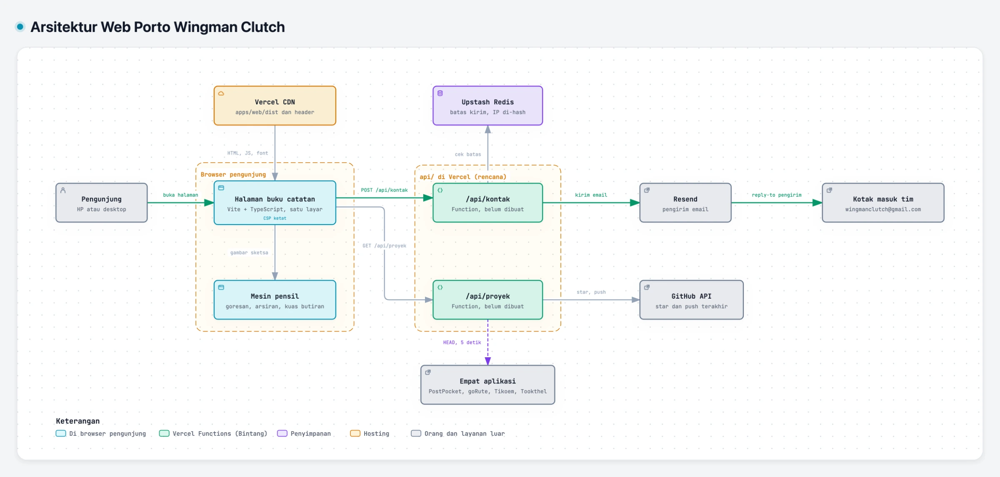

<!-- markdownlint-disable MD013 MD033 MD041 -->

<div align="center">

<picture>
  <source media="(prefers-color-scheme: dark)" srcset="docs/brand/wingman-clutch-horizontal-gelap.svg" />
  
</picture>

# Web Porto Wingman Clutch

**Two is enough to win.**

Satu halaman buku catatan yang memperlihatkan empat aplikasi Wingman Clutch.<br />
Tulisannya dicoret pensil langsung di layar, bendanya bisa diputar dan dicoba, dan pengunjung boleh ikut corat-coret.

### [Buka wingmanclutch.vercel.app](https://wingmanclutch.vercel.app)

[](https://github.com/Wingman-Clutch/wingmanclutch/actions/workflows/web.yml)
[](https://wingmanclutch.vercel.app)
[](https://vite.dev)
[](https://www.typescriptlang.org)
[](#cara-kerja)
[](docs/backend.md)

</div>

> [!NOTE]
> **Halamannya sudah live di [wingmanclutch.vercel.app](https://wingmanclutch.vercel.app) sejak 30 Oktober 2026**, dan Vercel men-deploy `main` ke produksi. Backend buatan Bintang (`/api/kontak` dan `/api/proyek`) juga sudah live mengikuti [kontrak](docs/api/openapi.yaml): pesan dari form kontak sampai ke email tim lewat Resend dengan batas kirim di Upstash, dan lembar detail menampilkan statistik GitHub. Progresnya ada di checklist [frontend](docs/frontend.md#checklist) dan [backend](docs/backend.md#checklist).

<picture>
  <source media="(prefers-color-scheme: dark)" srcset="docs/gambar/halaman-gelap.webp" />
  
</picture>

<p align="center">
  
  
  
  
</p>

## Kenapa

Wingman Clutch sudah merilis empat aplikasi, tapi belum ada satu tempat yang memperlihatkan semuanya beserta orang di baliknya. Kami mau web porto yang terasa seperti kami: main-main, buatan tangan, dan jelas soal apa yang sudah kami kirim. Tata letak dan urutan menggambarnya berangkat dari [kracked.studio](https://kracked.studio). Sejak 31 Oktober 2026 semua benda di halaman jadi figur Colorfigures, ditambah layar pembuka dan lampu bertali. Isi, sketsa, figur, dan kodenya milik kami sendiri.

## Fitur

- **Layar pembuka.** Lambang Wingman Clutch muncul di tengah kertas, mengepakkan sayap, lalu meluncur ke tempatnya sebelum halaman digambar. Tampil sekali per sesi dan berhenti begitu diketuk.
- **Digambar langsung.** Tanggal, tulisan logo, dan semua catatan dicoret pensil berurutan dalam ±3 detik, sementara figur diarsir masuk dengan krayon. Setiap goresan bergoyang seperti tangan.
- **Semua benda jadi figur.** PostPocket jadi amplop dengan kartu foil, goRute halte dan bus TransJakarta, Tikoem HP dengan peta titik kumpul, Tookthel printer struk dan koin. Kall dan Bintang yang tos, lambang, lampu, dan mug kopi juga figur 3D isometrik bergaya tinta tangan.
- **Lembar detail.** Ketuk sebuah figur: putar bendanya, tekan tombolnya (buka amplop, panggil bus, cari titik tengah, cetak struk, bahkan lihat isi printernya), lalu baca fitur, peran kami, tumpukan teknologi, statistik GitHub, dan tautan ke aplikasi serta kodenya.
- **Ambil pensil.** Lima pensil di baki untuk corat-coret di mana saja di halaman. Penghapusnya menggosok seluruh halaman, meninggalkan remah dan bekas abu-abu, lalu semuanya digambar ulang.
- **Tarik tali lampunya.** Lampu gantung di atas halaman: tarik talinya buat mematikan lampu (kertas gelap seperti kapur di papan tulis) atau menyalakannya lagi. Kupas sudut kanan atas halaman untuk masuk ke Matrix.
- **Lambang yang mengepak.** Setiap ketukan di lambang mengepakkan sayapnya dan menambah satu garis kepak.
- **Let's clutch it.** Form kontak yang dicek di browser, dikirim ke `/api/kontak`, dan jatuh ke email berisi pesan yang sama kalau server gagal.
- **Satu layar di mana saja.** Tata letak potret dan lanskap, muat tanpa scroll dari HP 320 px sampai monitor lebar. `prefers-reduced-motion` menggambar semuanya seketika, tanpa layar pembuka.

## Cara kerja

<sub>KODE → DIAGRAM · Peta sistem yang menaut ke baris kodenya</sub>

<a href="https://wingman-clutch.github.io/wingmanclutch/arsitektur.html">
<picture>
  <source media="(prefers-color-scheme: dark)" srcset="docs/gambar/arsitektur-gelap.webp" />
  
</picture>
</a>

**[Buka diagram interaktif ↗](https://wingman-clutch.github.io/wingmanclutch/arsitektur.html)** · [telusuri jalur Kirim pesan ↗](https://wingman-clutch.github.io/wingmanclutch/arsitektur.html#route=pengunjung~gmail) · [sumber JSON](docs/arsitektur.archify.json)

- **Mesin pensil sendiri.** Path SVG diurai jadi polyline, diberi goyangan tangan dan ujung kebablasan, lalu digambar sedikit demi sedikit dengan kuas bertekstur butiran yang menempel ke kertas ([`engine/`](apps/web/src/engine)). Benih acak per sketsa membuat gambarnya selalu sama.
- **Figur yang bisa dicoba.** Model 3D ditulis sebagai kode di [`figur/`](apps/web/figur) dengan engine [Colorfigures](https://april-zhu.com/colorfigures). Skrip membuat dua hasil: gambar diam untuk halaman, dan halaman interaktif yang dimuat di iframe hanya saat lembarnya dibuka.
- **Tanpa framework.** Vite dan TypeScript saja; seluruh JavaScript sekitar 51 KB gzip. Sketsa adalah kode ([`sketsa/`](apps/web/src/sketsa)), dan isi halaman ada di satu file ([`data/proyek.ts`](apps/web/src/data/proyek.ts)).
- **Kontrak dulu.** Halaman dan backend bertemu di [`docs/api/openapi.yaml`](docs/api/openapi.yaml). Halaman jalan dengan mock dari kontrak itu, dan unit test memvalidasi jawaban mock dengan skemanya, jadi Kall dan Bintang tidak saling menunggu.
- **Tetap jalan tanpa backend.** Kalau `/api/proyek` gagal, baris statistik disembunyikan; kalau `/api/kontak` gagal, pengunjung diarahkan ke email.
- **Tanpa pelacak.** Tidak ada cookie, analitik, atau domain luar. Tema disimpan di localStorage, dan coretan tidak dikirim ke mana pun.

## Mulai lokal

Butuh Node.js 24 (`.nvmrc`) dan pnpm 9.

```sh
git clone https://github.com/Wingman-Clutch/wingmanclutch.git
cd wingmanclutch
pnpm install          # sekalian mengaktifkan hook git
pnpm dev              # http://localhost:5180, /api dijawab mock
```

Pesan kontak yang memuat `#gagal` dijawab 503 dan `#sering` dijawab 429 oleh mock, untuk mencoba tampilan galat. Untuk mencoba dari HP di jaringan yang sama: `pnpm dev --host`.

| Perintah | Fungsi |
| --- | --- |
| `pnpm dev` | Server development halaman dengan mock API |
| `pnpm build` | Build produksi ke `apps/web/dist` |
| `pnpm lint` | oxlint (warning dianggap gagal) dan Prettier |
| `pnpm typecheck` | Cek tipe |
| `pnpm test` | Unit test Vitest |
| `pnpm test:e2e` | E2E Playwright di build produksi (desktop, Android, iPhone) |
| `pnpm check` | `lint`, `typecheck`, dan `test` sekaligus |

Pertama kali menjalankan E2E di mesin baru: `pnpm --filter @wingmanclutch/web exec playwright install chromium webkit`. Perintah backend ada di [AGENTS.md](AGENTS.md#6-perintah).

## Struktur

```text
wingmanclutch/
├── apps/web/              # halaman buku catatan (Kall)
│   ├── src/engine/        # mesin pensil: path, goresan, arsiran, kuas, tulisan, animasi
│   ├── src/sketsa/        # logo, catatan kecil, letak figur
│   ├── src/halaman/       # tata letak, kertas, papan, pensil dan penghapus, tema, dialog, kontak
│   ├── src/data/          # isi halaman, data font, logo, dan ukuran figur hasil skrip
│   ├── figur/             # sumber figur dan engine Colorfigures
│   ├── public/figur/      # hasil skrip: halaman figur interaktif dan gambar diam
│   ├── mock/              # mock /api sesuai kontrak (dev dan E2E saja)
│   ├── test/, e2e/        # Vitest dan Playwright
│   └── scripts/           # pembuat data font, logo, figur, gambar README dan OG
├── api/                   # Vercel Functions kontak dan proyek (Bintang)
├── docs/                  # PRD, panduan, desain, aset, kontrak API, diagram, gambar README
├── scripts/               # cek atribusi AI dan rahasia beserta ujinya
└── AGENTS.md              # aturan kerja untuk manusia dan AI agent
```

## Gerbang mutu

CI di GitHub Actions jalan di setiap PR dan setiap push ke `main`:

| Workflow | Isi |
| --- | --- |
| **Web** | Cek rahasia, lint, typecheck, unit test, lalu E2E Playwright di build produksi pada Chrome desktop, Pixel 7, dan iPhone 15 (WebKit) |
| **No AI attribution** | Menolak atribusi AI di commit dan PR. Juga dicek hook `commit-msg` dan `pre-push`, dan wajib lolos sebelum apa pun masuk `main` |

Unit test ikut menjaga desain: semua sketsa harus berada di dalam halaman dan tidak saling tindih di tata letak potret maupun lanskap, mock harus cocok dengan kontrak, hash CSP harus cocok dengan skrip tema, dan halaman figur harus membawa lisensi dan CSP-nya tanpa muatan dari luar.

## Keamanan dan privasi

- **CSP ketat.** Hanya skrip dari domain sendiri plus satu skrip tema yang di-hash; tidak ada domain luar sama sekali. Halaman figur punya CSP sendiri yang menutup semua koneksi, dan hanya boleh dibingkai halaman ini. Header keamanan lain diatur di [`vercel.json`](vercel.json).
- **Tanpa rahasia di repo.** Hook `pre-commit` menolak berkas `.env`, API key Resend, dan token GitHub; CI mengecek ulang semua berkas, dan secret scanning serta push protection GitHub menyala.
- **Data seperlunya.** Pesan kontak tidak disimpan di server, alamat IP hanya dipakai dalam bentuk hash untuk batas kirim, dan tidak ada cookie atau analitik.

## Deploy

| Bagian | Di mana | Catatan |
| --- | --- | --- |
| Halaman | Vercel (`haikalfaruqs-projects`), dari `main` | [wingmanclutch.vercel.app](https://wingmanclutch.vercel.app). `pnpm build`, hasil `apps/web/dist` ([`vercel.json`](vercel.json)). Tanpa env |
| Functions | Vercel, folder `api/` | Env `RESEND_API_KEY`, `KONTAK_TUJUAN`, `KONTAK_PENGIRIM`, `UPSTASH_*`, `GARAM_IP`, opsional `GITHUB_TOKEN` ([contoh](.env.example)) |
| Diagram arsitektur | GitHub Pages dari `main` `/docs` | [wingman-clutch.github.io/wingmanclutch/arsitektur.html](https://wingman-clutch.github.io/wingmanclutch/arsitektur.html) |

## Dokumentasi

| Dokumen | Isi |
| --- | --- |
| [PRD](docs/prd/PRD-WingmanClutch.md) | Sumber kebenaran produk: pemetaan dari referensi, persyaratan, kontrak, rencana kerja paralel, keputusan yang menunggu |
| [Panduan frontend](docs/frontend.md) | Cara kerja halaman dan mesin pensil, cara menambah aplikasi, test, checklist Kall |
| [Panduan backend](docs/backend.md) | Rancangan `/api/kontak` dan `/api/proyek`, keamanan, cara menjalankan, checklist Bintang |
| [Kontrak API](docs/api/openapi.yaml) | OpenAPI kedua endpoint |
| [Identitas visual](docs/desain.md) | Logo, warna pensil, huruf, dan aturan desain |
| [Aset dan lisensi](docs/assets.md) | Sumber dan lisensi setiap aset |
| [Referensi](docs/referensi/kracked-studio.md) | Cara kerja kracked.studio yang ditiru, dan apa yang kami ubah |
| [Diagram arsitektur](https://wingman-clutch.github.io/wingmanclutch/arsitektur.html) | Peta sistem interaktif yang menaut ke baris kode, sumbernya [`docs/arsitektur.archify.json`](docs/arsitektur.archify.json) |

## Berkontribusi

Alur kerja lengkapnya ada di [`AGENTS.md`](AGENTS.md). Ringkasnya:

1. Sinkron dulu (`git switch main && git pull`), lalu pastikan `git config core.hooksPath` mengeluarkan `.githooks`.
2. Buat branch `feat/…`, `fix/…`, atau `docs/…`, satu topik per PR. `main` hanya menerima PR.
3. Commit memakai Conventional Commits dalam Bahasa Indonesia, dengan pasangan sebagai co-author dan tanpa atribusi AI.
4. Deskripsi PR memakai bagian Apa yang berubah, Kenapa, Sudah dicek, dan Selanjutnya.
5. Setelah CI hijau, merge dengan **merge commit** (`gh pr merge --merge`).

## Tim

<table>
  <tr>
    <td align="center"><a href="https://github.com/HaikalFaruq"><br /><b>Muhammad Haikal Faruq</b></a><br /><sub>Frontend, desain, ilustrasi</sub></td>
    <td align="center"><a href="https://github.com/bintangfabian"><br /><b>Bintang Fabian Putra</b></a><br /><sub>Backend, keamanan, data</sub></td>
  </tr>
</table>

Tata letak dan interaksi rilis 1 terinspirasi [kracked.studio](https://kracked.studio); kode, sketsa, dan isinya milik Wingman Clutch. Figur digambar dengan engine [Colorfigures](https://april-zhu.com/colorfigures) karya April Zhu (MIT). Huruf dan aset pihak ketiga lainnya tercatat di [docs/assets.md](docs/assets.md).
